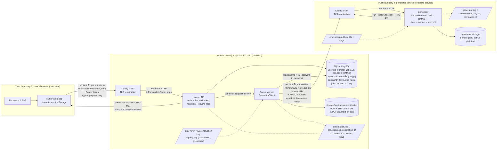

# 1. Data-flow diagram – trust boundaries and sensitive data

**Sensitive data in this system** (all fictional in the prototype):

| Item | Why it matters |
| --- | --- |
| **Requester name** | Personal information; printed on the certificate |
| **Requester ID number** (`2026-00001`) | Personal identifier; can link a person to school records |
| **Password** | Account takeover |
| **Bearer token** (Sanctum) | Works like a password for 8 hours |
| **Certificate PDF** | Contains name + ID number; an official-looking document |
| **Keys**: `APP_KEY`, exchange encryption key, exchange signing key, TLS private key | Whoever has them can read or forge everything above |

## Diagram

Dashed boxes are **trust boundaries**: data that crosses a boundary must be protected, and input arriving from
outside a boundary must be checked. Markers: 🔒T = protected in transit, 🔒R = protected at rest, 📝 = what goes into logs.

## Where sensitive data lives

| Data | At rest | In transit | In logs |
| --- | --- | --- | --- |
| Name | DB plaintext (needed for display and search); inside PDFs | TLS (browser ↔ API); TLS **+ AEAD** (worker → generator) | Never. Scanned: `evidence/week14/07-secret-scan.txt` |
| ID number | DB **encrypted** (Laravel `encrypted` cast); inside PDFs | TLS + AEAD to the generator; staff API sends a **masked** value (`2026-***01`) | Never |
| Password | **bcrypt** hash (cost 12) | TLS, once at login | Never (failed logins log only the IP) |
| Bearer token | SHA-256 hash in `personal_access_tokens` | TLS (`Authorization` header) | Never |
| Certificate PDF | Backend disk + generator disk (plaintext ⚠); SHA-256 in DB | TLS | Only certificate number and IDs |
| Keys | `.env` files only (git-ignored) | Copied by hand once (see key lifecycle) | Never; `GeneratorKeyring::__debugInfo` hides them |
| Queue payload | `jobs` table holds only `requestId` | — | — |

## How to explain it in the viva

- **Boundary 0 → 1:** the browser is untrusted. Everything is re-checked on the server (auth, role, validation), and
  the link is HTTPS so nobody on the network can read the password or token.
- **Boundary 1 → 2:** the generator is another service. TLS protects the connection, and on top of that the message
  protects itself: the personal fields are encrypted, and the whole request is signed and can only be used once.
  If TLS is ever terminated somewhere we don't control (a proxy, a load balancer), the name and ID number are
  still ciphertext.
- **At rest:** the ID number is encrypted in the database, so a stolen database file or backup doesn't reveal it.
  The PDFs on disk are still plaintext. That's a known residual risk (R2, R3 in document 6).
- **Logs:** they record *what happened* (event, IDs, status, reason code, correlation ID), never *who the person is*.
