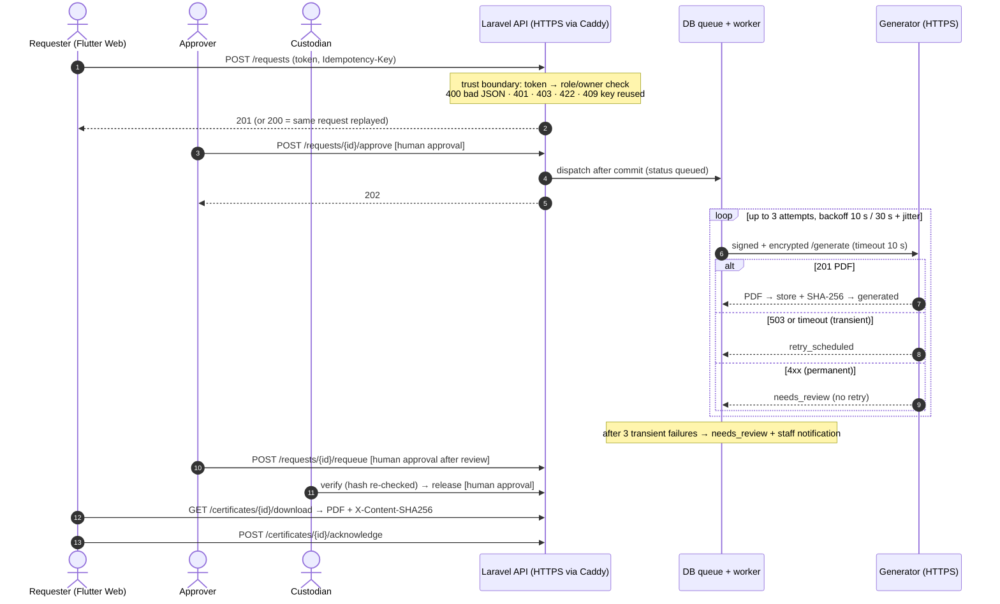

# 1. Test strategy, scope and decision record

Week 15 (IA6) – Integration Testing and Security Hardening · Project 21 Certificate Generation Queue

## 1.1 Bounded workflow under test

| Item | Value |
| --- | --- |
| **Actors** | Requester (student), Approving Staff, Document Custodian, queue worker (system), Certificate Generator Service (external dependency) |
| **Trigger** | A requester submits a certificate request; staff approve it |
| **Trusted inputs** | Bearer token (server checks role and ownership), `certificate_type` (enum), `purpose` (5–255 chars), optional `Idempotency-Key` |
| **Validation** | Server-side Laravel validation is authoritative; Flutter form validation only helps the user |
| **Processing** | approve → queue job → signed + encrypted call to the generator → PDF stored with SHA-256 → verify → release → download → acknowledge |
| **Outputs** | One certificate PDF per request, audit rows, JSON log lines with a correlation ID, in-app notifications |
| **External dependency** | Generator over HTTPS (`:8444`), which can be switched into failure modes (`GENERATOR_MODE`) |
| **Human approval points** | Approve/reject, re-queue after review, verify, release |
| **Non-goals** | Load testing (Week 16), real PDF service, email/SMS, production deployment, mobile builds |

## 1.2 Sequence diagram with failure paths

Sensitive data: the bearer token (client and transport only), the requester's name and ID number (encrypted on the wire
and at rest, never logged), and certificate PDFs (stored on disk, protected by a hash). Logs record IDs, statuses and
reason codes only.

## 1.3 Acceptance criteria (measurable)

| Area | Criterion |
| --- | --- |
| Normal | An approved request reaches `generated` on attempt 1 and can be verified, released, downloaded (hash matches) and acknowledged |
| Invalid input | Every invalid or boundary-violating input gets 4xx with the safe error format; nothing is stored |
| Unauthorized | No token / bad token → 401; wrong role → 403; another user's record → 404 |
| Duplicate | The same `Idempotency-Key` never creates a second request (sequential **and** parallel); repeated actions → 409 |
| Dependency failure | A failing generator ends in `needs_review` after **exactly 3** attempts; the requester sees a safe message |
| Timeout | A timeout is retried, bounded by 3 attempts, and never produces a second PDF |
| Recovery | After the generator is restored, staff re-queue and the item completes exactly once |
| Errors | Every response has `X-Correlation-ID`; no error body contains a stack trace, file path or exception name |
| Hardening | `composer audit` reports 0 advisories; hardening headers present; login time does not reveal whether an account exists |

## 1.4 Test layers

| Layer | Tool | What it proves | Where |
| --- | --- | --- | --- |
| Unit | PHPUnit | State machine rules | `backend/tests/Unit` |
| Feature/contract | PHPUnit (Laravel HTTP tests) | Each endpoint's status codes, JSON shape, roles, the real queue job with the generator faked, and each hardening fix | `backend/tests/Feature` (71 tests) |
| Integration (live) | **Postman collection run by Newman** | The real system (Caddy → API → queue worker → generator) over HTTPS, including failure modes | `tests/postman/` |
| Concurrency | `curl` in parallel (bash) | Duplicate submits at the same moment | `scripts/run-week15.sh` step 15.7 |
| Dependency | `composer audit` | No known vulnerable packages | step 15.1 |
| Client | `flutter test` + manual browser checks | Safe messages, pagination, responsive layout | `frontend_flutter/test` (14 tests) |

## 1.5 Environment and test data

- macOS, PHP 8.5.9, Laravel 13.43 (13.39 before the sprint), Node 24 + Newman 6.2.1 via `npx`, Caddy, SQLite, database queue.
- API started with `PHP_CLI_SERVER_WORKERS=4` so the parallel-submit test really runs in parallel.
- **Fictional data only**: the seeded accounts `juan`, `maria`, `approver`, `custodian` `@example.test` with the demo password
  printed in the README. The Postman environment file holds only the base URL and that demo password; tokens are created
  at run time and kept in a temporary file that the script deletes.
- No production endpoint, real personal record or real key appears in the collection, environment file or evidence
  (step 15.9 scans the evidence folder).

## 1.6 Entry and exit criteria

- **Entry:** health check shows `database: ok, generator: ok`; generator mode `success`; worker running.
- **Exit:** every collection assertion passes in the after run, all automated tests pass, `composer audit` is clean, and
  every defect found has a record with retest evidence. Failures from the baseline run are kept, not deleted.

## 1.7 Decision record: how to run the integration tests

**Decision question:** How should the live integration tests be written so they are repeatable, reviewable and can
exercise failure modes?

| Option | Advantages | Disadvantages |
| --- | --- | --- |
| **A. Postman collection + Newman CLI** (chosen) | The format the module asks for; readable per request; assertions per response; opens in the Postman app for demos; Newman runs it headless and writes JUnit XML | Needs Node.js; JavaScript test scripts; cannot switch the generator's mode by itself; timing assertions are a little noisy |
| B. Extend the bash/curl evidence script (Weeks 13–14) | No new tool; full control | Assertions are hand-written string checks; hard for another student to read or extend; no per-request report |
| C. PHPUnit feature tests only | Fast, deterministic, already 59 tests | Not the live system: no Caddy, TLS, real worker or real generator; can't find configuration or deployment defects |

**Decision:** A for the live system, wrapped by `scripts/run-week15.sh`, which switches `GENERATOR_MODE` between folders.
C stays as the fast regression layer, and every hardening fix gets a PHPUnit test as well.

**Consequences / new responsibilities:** the collection must be kept in step with the API (it is generated from
`tests/postman/build-collection.mjs`; rebuild after changes). Node.js becomes a test-time dependency. The timing check
uses a 50 % margin to avoid false failures, so it detects big differences (like 10 ms vs 227 ms), not small ones.

**Review condition:** revisit if the API gains an OpenAPI description (then generate contract tests from it), or if
the team moves to CI (run Newman in the pipeline).
